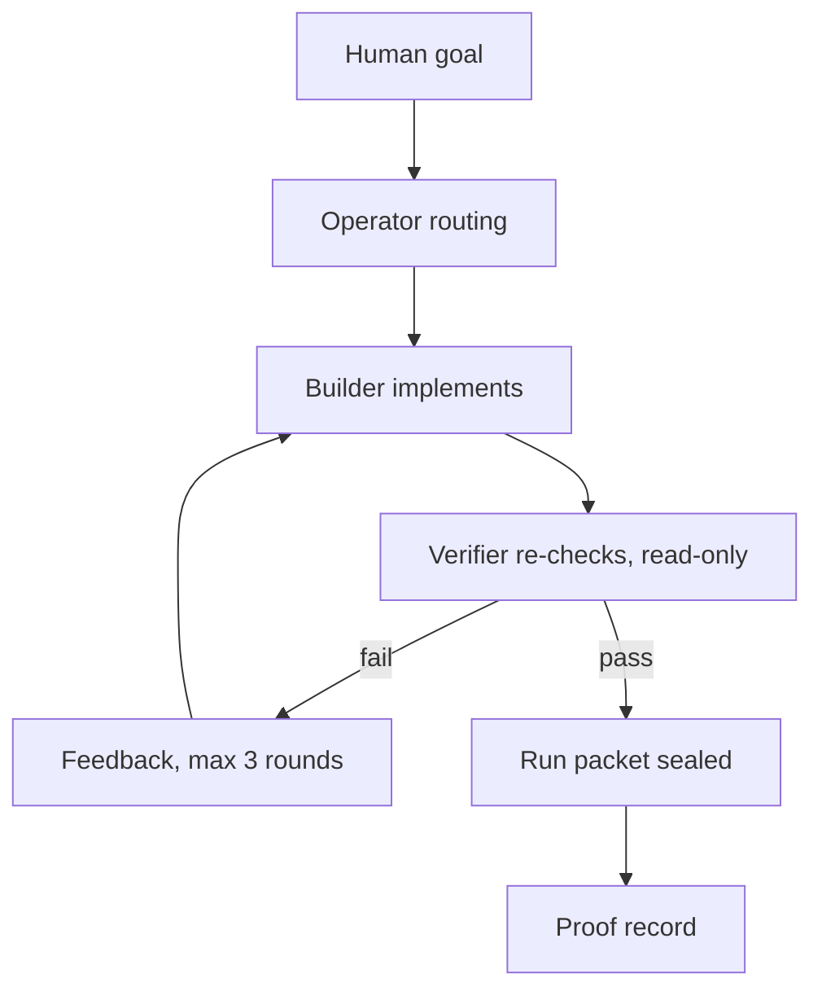

# jake-studio

A local-first operator layer that routes agent work across builders,
verifiers, and verification gates, with the rig-l10 harness doing the
certainty checks. Internal names are translated in the
[glossary](docs/glossary.md).


[](https://github.com/mrodgersjs-web/jake-studio/actions/workflows/smoke.yml)

## Why this exists

Agent work fails in a specific way: the same agent writes the change and
then grades it. This repo keeps those roles separate and refuses a
completion claim without evidence. It is the working loop behind a sealed
proof: build, re-check with a read-only verifier, and record what happened.

## Quickstart

```bash
git clone https://github.com/mrodgersjs-web/jake-studio.git
cd jake-studio/packages/l10
pip install -e '.[dev]'
pytest -q
```

## What it proves

Run these after install:

```bash
pytest -q            # 73 passing
ruff check .         # All checks passed
rig-l10 doctor       # modules load, exit 0
```

## How it works



The law the code enforces: a role never verifies the packet it generated.
The chassis runtime (harness registry, typed run packets, workflow state
machine, durable state store, tool registry with side-effect gates, policy
engine) lives in `packages/l10/src/chassis`; its contract is
`packages/l10/docs/chassis/spec.md`.

## Project layout

```
packages/l10/         the rig-l10 Python package (src, tests, docs)
packages/operator/    operator loader scripts
docs/                 architecture, glossary, public boundary
examples/             runnable examples, exercised by the test suite
scripts/smoke.sh      one-line install-and-smoke check
```

## Development

```bash
cd packages/l10
python3 -m venv .venv && . .venv/bin/activate
pip install -e '.[dev]'
pytest -q --cov
ruff check .
```

## Documentation

- [Glossary](docs/glossary.md): internal names in plain English
- [Architecture](docs/architecture.md): how the parts fit
- [Chassis spec](packages/l10/docs/chassis/spec.md): the runtime contract
- [Public boundary](docs/public-boundary.md): what this repo does not publish

## Contributing

See [CONTRIBUTING.md](CONTRIBUTING.md). Small diffs, tests included,
`ruff check .` and `pytest -q` green before a PR.

## Security

Report vulnerabilities to security@rodgersintelligence.com. See
[SECURITY.md](SECURITY.md).

## License

MIT. See [LICENSE](LICENSE).

---

Built by Mike Rodgers · rodgersintelligence.com
